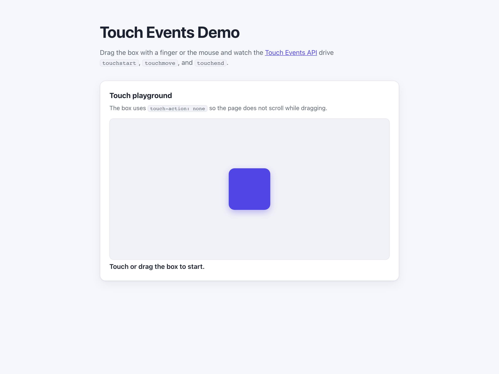

# WebSharper.TouchEvents

[](https://github.com/dotnet-websharper/TouchEvents)

WebSharper bindings for the [Touch Events API](https://developer.mozilla.org/en-US/docs/Web/API/Touch_events) —
handling `touchstart`, `touchmove`, and `touchend` in F# and C# web apps.

Touch events are the browser's low-level pointer interface for touch screens. The binding exposes the
`Touch`, `TouchList`, and `TouchEvent` types together with their configuration objects.

This repository contains:

| Project | Purpose |
| --- | --- |
| `WebSharper.TouchEvents` | The binding: WIG definitions for `Touch`, `TouchList`, `TouchEvent`, `TouchInit`, and `TouchEventOptions`. |
| `WebSharper.TouchEvents.Sample` | An ASP.NET Core SPA with a draggable box driven by the touch events. |

## Live demos

**Try it live:** [Open the sample in your browser](https://dotnet-websharper.github.io/TouchEvents/)



The sample doubles as the binding's [test case](#running-the-sample): it attaches `touchstart`, `touchmove`, and `touchend` handlers to a movable box and reports the touch state in the page.

- **Sample (this repository):** <https://dotnet-websharper.github.io/TouchEvents/>
- **Source repository:** <https://github.com/dotnet-websharper/TouchEvents>
- **WebSharper bindings:** <https://websharper.com/bindings>

## Features

- `TouchEvent` extends `Dom.Event`, with `touches`, `targetTouches`, `changedTouches`, and the modifier keys.
- `TouchList` with `length` and `item(index)`.
- `Touch` with `identifier`, `screenX`, `screenY`, `clientX`, `clientY`, `pageX`, `pageY`, `target`, `radiusX`, `radiusY`, `rotationAngle`, and `force`.
- `TouchInit` and `TouchEventOptions` configuration types, plus the `TouchEvent` constructor.

## Installation

The binding is not currently published to NuGet. Reference the project from source:

```bash
git clone https://github.com/dotnet-websharper/TouchEvents.git
```

```xml
<ItemGroup>
  <ProjectReference Include="path/to/WebSharper.TouchEvents/WebSharper.TouchEvents.fsproj" />
</ItemGroup>
```

## Usage

```fsharp
namespace WebSharper.TouchEvents.Demo

open WebSharper
open WebSharper.JavaScript
open WebSharper.TouchEvents

[<JavaScript>]
module Demo =
    let attachTouchEvents (box: Dom.Element) =
        box.AddEventListener("touchstart", fun (e: Dom.Event) ->
            let touch = (As<TouchEvent>(e)).Touches.[0]
            Console.Log $"touch started at {touch.ClientX}, {touch.ClientY}"
        )

        box.AddEventListener("touchmove", fun (e: Dom.Event) ->
            e.PreventDefault()
            let touch = (As<TouchEvent>(e)).Touches.[0]
            Console.Log $"moving to {touch.ClientX}, {touch.ClientY}"
        )

        box.AddEventListener("touchend", fun (_: Dom.Event) ->
            Console.Log "touch ended"
        )
```

Set `touch-action: none` on the element in CSS so the browser does not scroll while the finger moves.
`TouchList` exposes `item(index)`; `.[0]` also resolves to the first touch.

## Running the sample

Build the sample in Release and serve its static output:

```bash
dotnet build WebSharper.TouchEvents.Sample/WebSharper.TouchEvents.Sample.fsproj -c Release
python3 -m http.server -d WebSharper.TouchEvents.Sample/wwwroot 8101
```

Open <http://localhost:8101/>. The page renders the draggable box and the live touch status. Drag the box with a
finger or a device-emulation touch pointer.

Alternatively, run the ASP.NET Core host:

```bash
dotnet run --project WebSharper.TouchEvents.Sample
```

## Building from source

### Prerequisites

- [.NET SDK 10](https://dotnet.microsoft.com/download) or later.

### Build

```bash
dotnet build WebSharper.TouchEvents.sln -c Release
```

The binding targets `netstandard2.0`; the sample targets `net10.0`.

## Deployment

Pushing to `main` triggers `.github/workflows/ghpages.yml`, which builds the sample in Release and publishes
`WebSharper.TouchEvents.Sample/wwwroot` to the `gh-pages` branch.

## Repository layout

```
WebSharper.TouchEvents/              # binding (WIG definitions)
  Main.fs
WebSharper.TouchEvents.Sample/       # ASP.NET Core SPA demo
  Client.fs
  Startup.fs
  wwwroot/
    index.html
    site.css
    Content/                         # generated at build time (gitignored)
docs/sample.png
.github/workflows/ghpages.yml        # build + deploy the sample to GitHub Pages
```

## Notes on the API

- **Touch devices:** touch events are not fired by a mouse. Use a touch screen or the browser's device
  emulation (for example, Chrome DevTools' device toolbar).
- **`touch-action`:** set `touch-action: none` on the draggable element to prevent the browser's default
  scrolling and zooming gestures from interrupting the drag.
- **Touch lists:** `touches`, `targetTouches`, and `changedTouches` are `TouchList` values. Read the first
  touch with `item(0)` or `.[0]`.
- **Prevent default:** call `e.PreventDefault()` in `touchmove` when the page should not scroll during the drag.
- **Mouse and pointer fallback:** for a single input path that works with both mouse and touch, use pointer
  events (`PointerEvent`) instead of the touch-specific API.

## License

Apache 2.0 — see [LICENSE.md](LICENSE.md).
